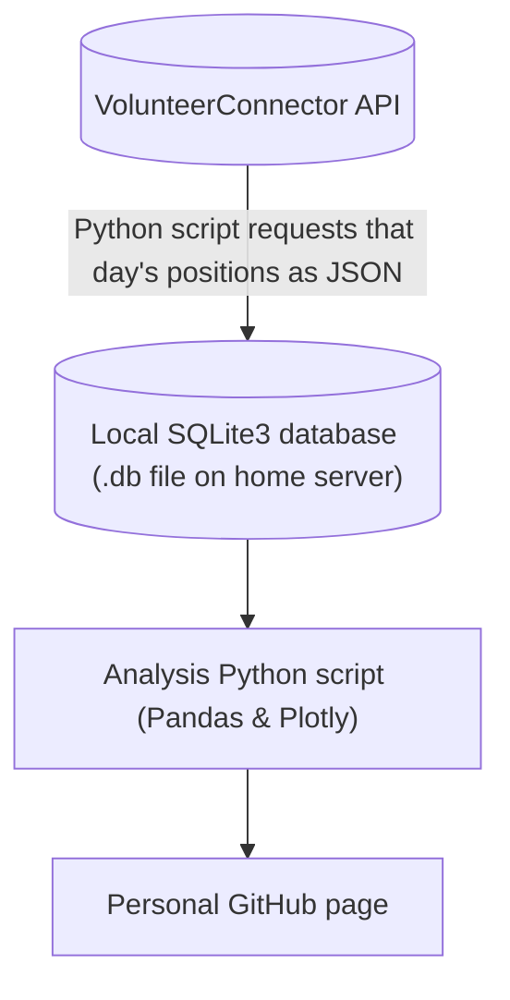

Note: This dashboard is no longer updated. Data collection stopped on April 30, 2025, so some plots have limited data.

## 1. Dashboard Introduction

This is a dashboard that tracks Canadian Volunteer Opportunities from the VolunteerConnector API. It shows the volunteer landscape up to April 30, 2025, when updates stopped.
The goals are to track the following differences once there is enough data:
- Temporary vs Evergreen Postings
- Student vs non-Student positions
- Non-Senior vs Senior positions
- Rural vs Urban positions
- Remote vs In-person positions

## 2. Opportunity Landscape



## 3. Geographic & Organizational Insights
Overwhelmingly VolunteerConnector is used by Western Canada.



## 4. Filterable Histogram
This chart has too little data to show strong trends.



## 5. How was all of this done?
This is (almost) entirely automated. The only thing that isn't automated is the final step of pushing the changes to the page.
The pipeline is below:

