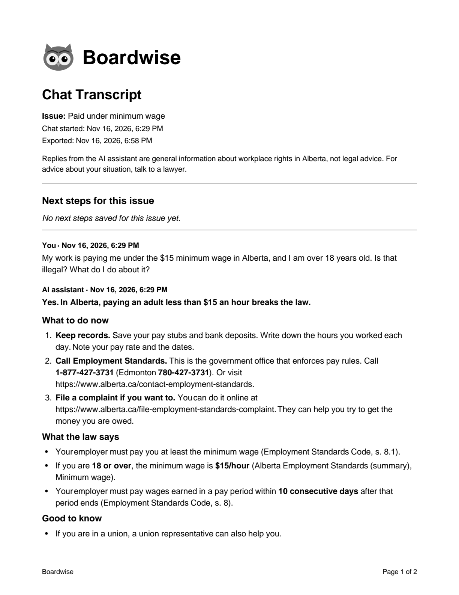

**NatHacks 2026 · Problem Provider track · Team lead**

## Summary

Our problem provider, Jeff, joined a crew that had worked around silica dust for years. The dust covered their equipment, there was no safety data sheet, and the crew breathed it in day after day without proper protection. They had accepted this as normal. Jeff looked up Alberta's safety rules himself, found it wasn't legal, and reported it.

Checking a contract or the law against what happens on the job usually means going home and spending your own time reading legal text, which most workers don't have the time or energy for. Boardwise does that reading for them. A worker asks a question in their own words and gets an answer drawn from Alberta's workplace laws, WCB rules and government guides, with the source cited. Answers are written at a grade 6 reading level, questions can be spoken instead of typed, and replies can be read aloud. [Source on GitHub](https://github.com/Avg-user/boardwise)




## Signing In

Each worker's issues are private to their account. A Quick Exit button and an auto-lock are there for anyone using a shared or watched device.




## Asking Out Loud

Workers can speak a question instead of typing it. The words appear as they talk, and the audio is transcribed on our own server, so it never leaves it.




## Listening to the Answer

Any reply can be read aloud in a natural voice, with the current sentence highlighted. Answers lead with what to do, use short sentences, and explain legal terms the first time they come up.




## Exporting the Chat

A chat can be downloaded as a PDF to bring to a lawyer or to Employment Standards. ([Full PDF](/assets/postImages/post4/export.pdf))

## My Role

I led a team of four and built the following:
- The AI chat, tuned to a grade 6 reading level.
- The sources the chat cites: Alberta's workplace laws, WCB rules and government guides.
- Speech-to-text, run locally.
- The natural read-aloud voice, with each sentence highlighted as it is read.
